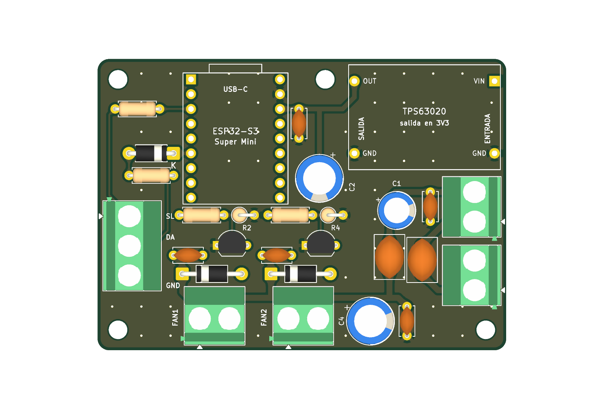

# kicad-scripted-pcb

A Claude skill for designing manufacturable printed circuit boards in **KiCad 10** entirely from
Python scripts: the schematic and the board are generated from one parts table, routed with
octilinear tracks (no 90° corners), verified with KiCad's ERC, DRC and schematic↔PCB parity plus
a routing-geometry checker, and exported as Gerbers, drill files, BOM, PDF and 3D renders ready
for JLCPCB or PCBWay.

  

## What it gives Claude

- **A workflow**: requirements → single parts table → schematic (ERC 0) → placement by
  functional zones → octilinear routing → silkscreen → DRC + parity + routing check at zero →
  fabrication files → a "measure before ordering" list.
- **Scripts**: `check_routing.py` (what DRC does not check: angles, octilinearity, widths per
  class) and `kisexpr.py` (KiCad S-expressions and stock-symbol extraction).
- **Templates**: working schematic and board generators to adapt.
- **References**: routing rules (IPC-2221), KiCad 10 scripting quirks, schematic layout, an
  ordering and assembly checklist.
- **A real example**: one circuit, three board versions (70 × 50 mm; all connectors in one row;
  regulator module mounted on the board), all passing every check.

## Install

Copy the folder into your skills directory (for Claude Code: `~/.claude/skills/kicad-scripted-pcb`)
or package it as a `.skill` file. Claude loads it when you ask for a schematic, a PCB, KiCad files
or Gerbers.

## Requirements

- KiCad 10 (its bundled Python provides `pcbnew`; `kicad-cli` does ERC, DRC, zone filling and
  exports).
- Tested on Windows 11; the scripts look for KiCad's libraries in the usual Linux and macOS
  paths too.

## License

MIT — see [`LICENSE`](LICENSE).
